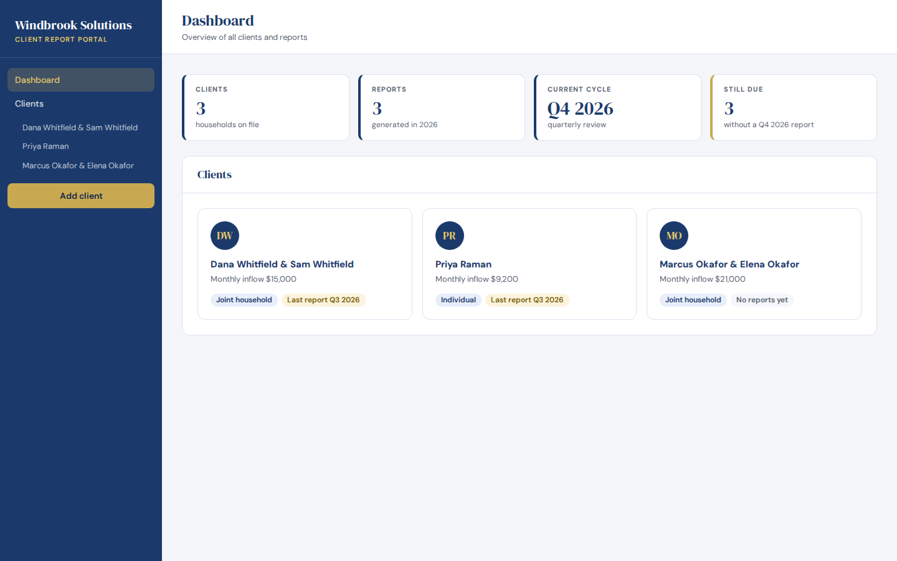
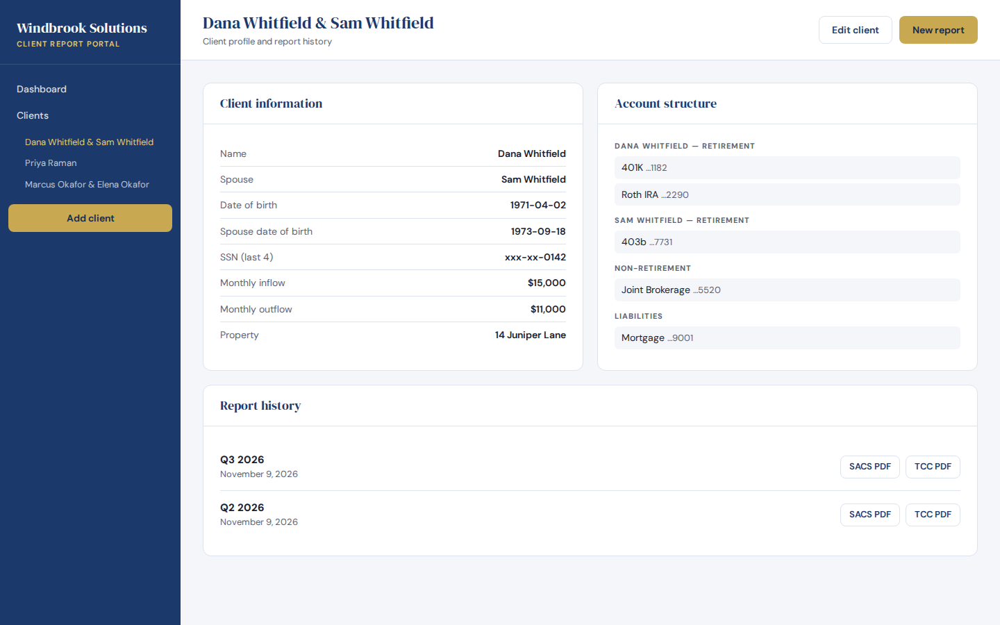
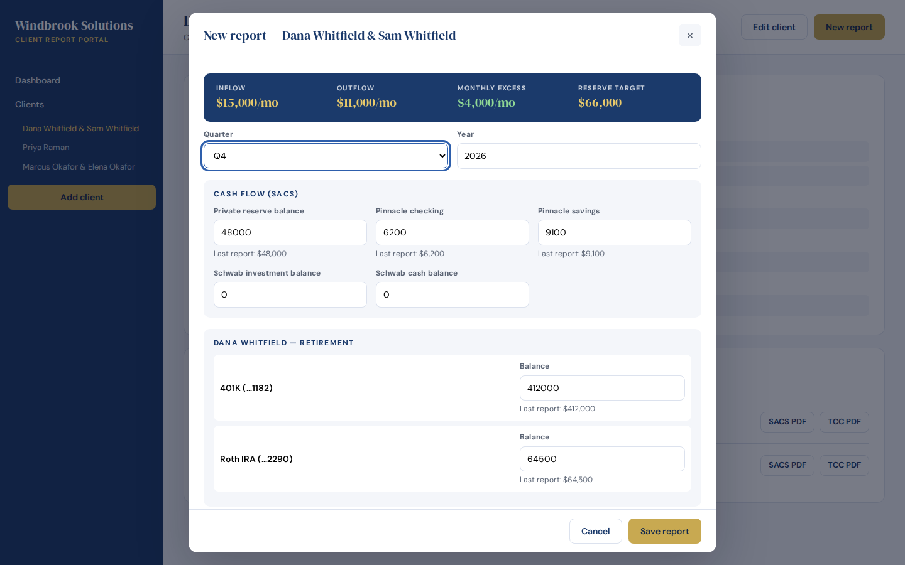
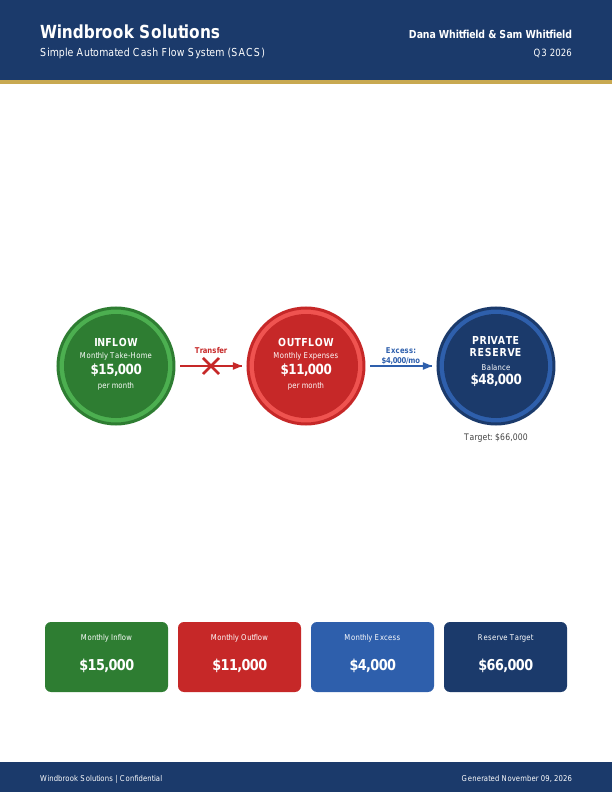
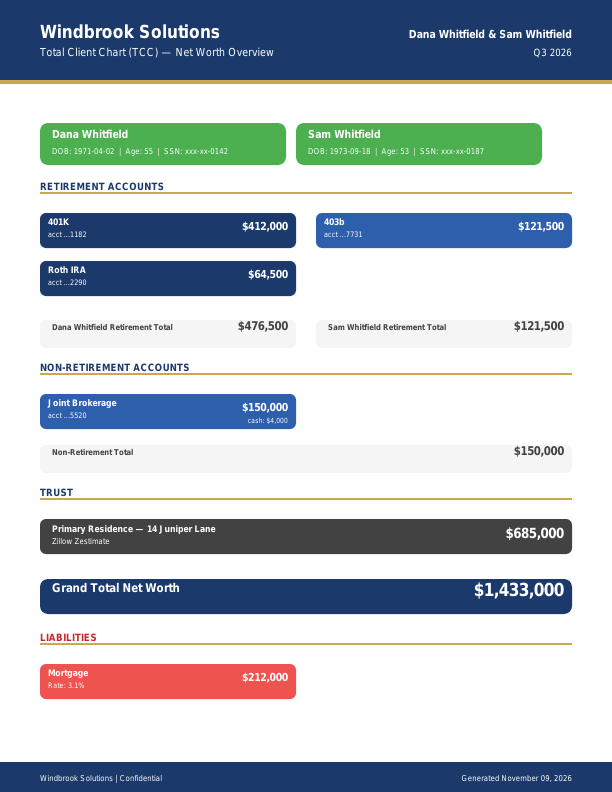
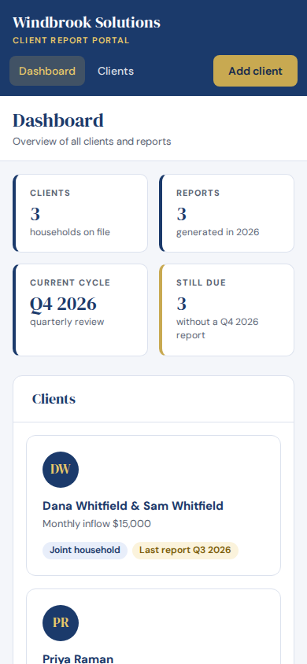
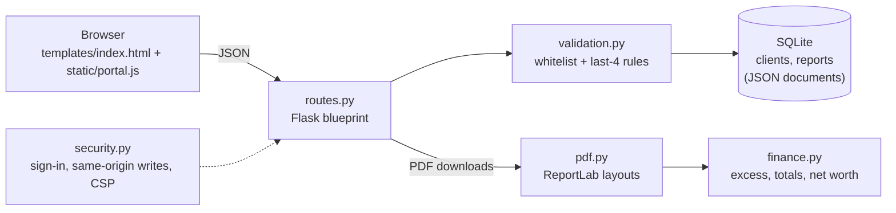

# Client Report Portal

A small internal tool for a wealth-management team that prepares two PDFs for every client household each quarter:

- **SACS** (Simple Automated Cash Flow System): the monthly inflow → outflow → private reserve diagram.
- **TCC** (Total Client Chart): net worth across retirement, non-retirement and trust assets, with liabilities listed separately.

Each household's profile and account structure is entered once. Every quarter someone types in the new balances, with last quarter's figures shown beside each field, and downloads both PDFs. Past reports stay available for re-download.



## What it does

| Area | Details |
|---|---|
| Client profiles | Names, dates of birth, SSN **last four only**, monthly inflow/outflow, reserve target and the list of accounts per spouse |
| Quarterly entry | Balances for the private reserve, Pinnacle checking/savings, Schwab, each retirement and brokerage account, the home value and each liability. Last quarter's value is shown under each input |
| Live totals | Retirement total per spouse, non-retirement, trust, grand total net worth and liabilities, updated while typing |
| SACS PDF | Two pages: the cash-flow bubble diagram with summary boxes, then account detail and total liquid assets |
| TCC PDF | Net-worth overview. Long account lists continue onto a second page instead of running off the sheet |
| History | Every saved report can be downloaded again. The dashboard shows which households still need this quarter's report |

| Client page | Quarterly entry |
|---|---|
|  |  |

| SACS page 1 | TCC page 1 | Phone layout |
|---|---|---|
|  |  |  |

All names, figures and addresses in the screenshots are fictional demo data from `flask --app app seed-demo`.

## Running it

### With Docker (recommended)

```bash
cp .env.example .env        # set PORTAL_PASSWORD before sharing the URL
docker compose up -d --build
docker compose exec portal flask --app app seed-demo   # optional demo households
```

Open http://localhost:8000. If `PORTAL_PASSWORD` is set, the browser asks for `PORTAL_USERNAME` (default `admin`) and that password. The SQLite database lives in the `portal-data` volume.

### Without Docker

Requires Python 3.12.

```bash
python -m venv .venv && . .venv/bin/activate
pip install -r requirements.txt
flask --app app seed-demo          # optional
flask --app app run                # http://127.0.0.1:5000
```

The database defaults to `./portal.db`. Settings are read from environment variables:

| Variable | Default | Purpose |
|---|---|---|
| `DATABASE_PATH` | `portal.db` (`/data/portal.db` in Docker) | SQLite file. `RAILWAY_DATABASE_PATH` is still honoured |
| `PORTAL_PASSWORD` | empty (no sign-in) | Turns on HTTP Basic sign-in for every page except `/healthz` |
| `PORTAL_USERNAME` | `admin` | Username for that sign-in |
| `FIRM_NAME` | `Windbrook Solutions` | Shown in the portal header and on every PDF |
| `PORT` | `8000` in Docker | Port gunicorn binds to |

### Deploying

`Procfile` and `railway.toml` start the same gunicorn command the Docker image uses. Railway's healthcheck points at `/healthz`, which stays reachable when sign-in is on. Set `PORTAL_PASSWORD` on any deployment other people can reach.

## Tests

```bash
pip install -r requirements-dev.txt
pytest          # API, validation, security, arithmetic and PDF structure
ruff check . && ruff format --check .
```

The PDF tests read generated files back with `pypdf` and check page count, page size, title metadata and the text drawn on each page, such as the household name, the totals and the masked SSN. They don't compare pixels, so small layout tweaks won't break them, but a wrong total will.

## How it is put together



```
app.py              gunicorn / flask entry point (create_app)
portal/
  __init__.py       app factory and configuration
  db.py             per-request SQLite connection and queries
  routes.py         JSON API, PDF downloads, the page
  validation.py     what may be stored for a client or report
  security.py       optional sign-in, CSRF guard, response headers
  finance.py        SACS/TCC arithmetic, testable without drawing
  pdf.py            the two ReportLab layouts
  demo.py           fictional households for `flask --app app seed-demo`
  templates/, static/
tests/
```

### API

All endpoints take and return JSON. Writes must come from the same origin, so browsers sending a foreign `Origin` or `Sec-Fetch-Site: cross-site` get `403`.

| Method | Path | |
|---|---|---|
| GET | `/api/clients?year=2026` | Clients plus `reports_this_year` and `last_report` |
| POST / PUT / DELETE | `/api/clients`, `/api/clients/<id>` | Create, update, delete (delete removes the client's reports) |
| GET / POST | `/api/clients/<id>/reports` | Report history (newest first) / save a quarter |
| GET | `/api/reports/<id>/sacs.pdf`, `/api/reports/<id>/tcc.pdf` | The PDFs |
| GET | `/healthz` | Liveness, no sign-in |

Captured from the test client:

```http
POST /api/clients
{"name_1": "Priya Raman", "ssn_1": "123-45-6789"}

400 {"error": "invalid fields", "fields": {"ssn_1": "must be at most the last 4 digits"}}
```

```http
GET /api/clients?year=2026

200 [{"id": 1, "name_1": "Priya Raman", "ssn_1": "0311", "monthly_salary": 9200.0,
      "expense_budget": 6100.0, "retirement_accounts_1": [{"type": "SEP IRA", "acct_num": "4410", "rate": ""}],
      "reports_this_year": 1, "last_report": "Q3 2026", "updated_at": "2026-11-09 18:09:39", ...}]
```

## Design decisions

- **No bank or Zillow integrations.** Balances are typed in each quarter: Pinnacle figures arrive by email, Schwab is checked by hand and the home value comes from a Zillow lookup.
- **Liabilities are never subtracted from net worth.** The client asked for them as a separate section, and `finance.tcc_totals` and its tests keep it that way.
- **The trust (home) value is separate from the non-retirement total.** It is added only into the grand total.
- **Private reserve target defaults to 6 × monthly expenses** when the profile leaves it blank.
- **Fixed PDF layout.** Positions don't depend on how large the numbers are. The TCC adds a "(continued)" page rather than shrinking content.
- **SQLite with JSON documents.** It suits the 6–12 households this is built for. Stored fields are whitelisted on the way in, so the documents keep a known shape.
- **Sensitive identifiers are truncated at the door.** SSNs and account numbers are limited to their last four digits, so a full number is rejected rather than stored.
- **The UI runs under `script-src 'self'`** with no inline handlers, and every API value is HTML-escaped before rendering.

## Known gaps

- Sign-in is a single shared HTTP Basic account. That suits a three-person team behind HTTPS but gives no per-user audit trail.
- Canva export and Dropbox auto-save were discussed for this version but not confirmed, so they aren't built. PDF download is the output.
- The PDF layouts follow the described structure (bubble diagram, sections, totals) but haven't been compared pixel for pixel against the team's existing templates.
- The reserve target doesn't yet add insurance deductibles. Add them to the target field by hand for now.
- Account balances are matched to last quarter by position. Reordering a client's accounts shifts the "last report" hints.

## License

MIT, see [LICENSE](LICENSE).
